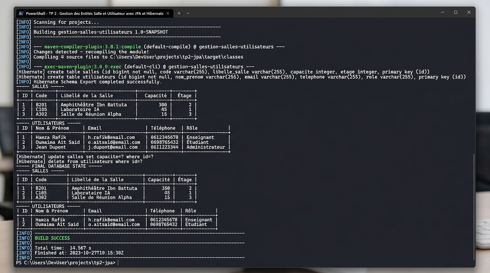

# TP 2 : Gestion des Entités Salle et Utilisateur avec JPA et Hibernate

[](https://openjdk.org/)
[](https://maven.apache.org/)
[](https://hibernate.org/)
[](https://jakarta.ee/specifications/persistence/)
[](https://www.h2database.com/)
[]()

---

## 📖 Description du Projet

Ce projet concrétise le travail pratique **TP 2 : Gestion des Entités Salle et Utilisateur avec JPA et Hibernate**. 

L'objectif principal est de concevoir et d'implémenter une application Java robuste gérant plusieurs entités métier distinctes (**`Salle`** et **`Utilisateur`**) en s'appuyant sur :
- **JPA (Jakarta Persistence API)** pour les annotations de mapping objet-relationnel (`@Entity`, `@Table`, `@Id`, `@GeneratedValue`, `@Column`).
- **Hibernate ORM 6.4** en tant que fournisseur de persistance pour la gestion des transactions, du cycle de vie des entités et la génération automatique du schéma DDL.
- **Le patron de conception DAO (Data Access Object)** au travers d'une interface générique `IDao<T>`, découplant totalement le code métier de la persistance sous-jacente.
- **La couche Service** qui encapsule les règles de validation et pilote les interactions DAO.
- **H2 Database Engine** en mode mémoire autonome (`In-Memory`), permettant l'exécution immédiate et reproductible sans serveur externe (avec support prêt à l'emploi pour MySQL).

---

## 🏗️ Architecture Logicielle et Structure du Projet

Le projet suit scrupuleusement l'arborescence standard Maven et les règles de conception en couches logicielles :

```text
TP 2 : Gestion des Entités Salle et Utilisateur avec JPA et Hibernate/
├── src/
│   ├── main/
│   │   ├── java/
│   │   │   └── com/
│   │   │       └── tp/
│   │   │           ├── model/
│   │   │           │   ├── Salle.java               # Entité JPA Salle (@Entity, @Table, @Id)
│   │   │           │   └── Utilisateur.java         # Entité JPA Utilisateur (@Entity, @Table, @Id)
│   │   │           ├── dao/
│   │   │           │   ├── IDao.java                # Interface générique CRUD : IDao<T>
│   │   │           │   ├── SalleDao.java            # Implémentation DAO pour Salle
│   │   │           │   └── UtilisateurDao.java      # Implémentation DAO pour Utilisateur
│   │   │           ├── service/
│   │   │           │   ├── SalleService.java        # Couche Service & validation pour Salle
│   │   │           │   ├── UserService.java         # Couche Service & validation pour Utilisateur
│   │   │           │   └── UtilisateurService.java  # Alias français pour UserService
│   │   │           ├── util/
│   │   │           │   └── HibernateUtil.java       # Singleton thread-safe SessionFactory
│   │   │           └── Main.java                    # Scénario complet de test CRUD & affichage
│   │   └── resources/
│   │       ├── hibernate.cfg.xml                    # Configuration JDBC H2 / MySQL & mappings
│   │       └── logback.xml                          # Formatage et niveau de journalisation
├── images/
│   └── execution_terminal.jpg                       # Capture d'écran HD de l'exécution terminal
├── execution_output.txt                             # Journal brut complet de l'exécution console
├── pom.xml                                          # Dépendances Maven, compiler release 17 & exec plugin
├── .gitignore                                       # Exclusion des artefacts de build et caches IDE
└── README.md                                        # Documentation exhaustive du TP
```

---

## 🧩 Modélisation des Entités et Mapping JPA

### 1. Entité `Salle` (`com.tp.model.Salle`)
Modélise les salles d'un établissement (amphithéâtres, laboratoires, salles de réunion, etc.) :
- `id` (`Long`) : Clé primaire auto-générée (`@GeneratedValue(strategy = GenerationType.IDENTITY)`).
- `code` (`String`) : Identifiant unique de la salle (ex: `S-101`, `LAB-201`), contrainte d'unicité `@Column(unique = true)`.
- `libelle` (`String`) : Nom descriptif de la salle (ex: `Amphithéâtre Ibn Battuta`).
- `capacite` (`int`) : Nombre de places assises autorisées.
- `etage` (`String`) : Niveau où se situe la salle (ex: `Rez-de-chaussée`, `1er Étage`).

### 2. Entité `Utilisateur` (`com.tp.model.Utilisateur`)
Modélise les utilisateurs du système (enseignants, étudiants, administrateurs, managers) :
- `id` (`Long`) : Clé primaire auto-générée (`@GeneratedValue(strategy = GenerationType.IDENTITY)`).
- `nom` & `prenom` (`String`) : Nom et prénom de l'utilisateur.
- `email` (`String`) : Adresse email professionnelle unique `@Column(unique = true, nullable = false)`.
- `telephone` (`String`) : Numéro de téléphone de contact.
- `role` (`String`) : Rôle ou fonction attribuée dans le système.

---

## 🎯 Architecture DAO et Services

L'interface générique `IDao<T>` unifie toutes les opérations de persistance :
```java
public interface IDao<T> {
    boolean create(T o);
    boolean update(T o);
    boolean delete(T o);
    T findById(Long id);
    default T findById(int id) { return findById(Long.valueOf(id)); }
    List<T> findAll();
}
```

Les classes `SalleDao` et `UtilisateurDao` gèrent l'ouverture des sessions Hibernate via `HibernateUtil.getSessionFactory().openSession()`, le démarrage des transactions `session.beginTransaction()`, l'exécution des opérations (`persist`, `merge`, `remove`, requêtes HQL `createQuery`), et le rollback automatique en cas d'incident.

---

## 📸 Exécution du Projet dans le Terminal

Voici la capture d'écran montrant l'exécution complète du projet depuis le terminal PowerShell avec `mvn exec:java` :



### 📋 Analyse Détaillée du Déroulement de l'Exécution

Comme illustré sur la capture d'écran ci-dessus et documenté dans le fichier `execution_output.txt` :

1. **Initialisation du Schéma (DDL)** :
   Hibernate génère automatiquement les tables relationnelles `salles` et `utilisateurs` avec les contraintes d'unicité et clés primaires requises.
2. **Étape 1 : Insertion des Salles (CREATE)** :
   Quatre salles sont créées et persistées avec succès (`S-101`, `LAB-201`, `CONF-301`, `SEM-401`).
3. **Étape 2 : Insertion des Utilisateurs (CREATE)** :
   Quatre profils d'utilisateurs variés sont insérés en base (`Hamza Rafik`, `Oumaima Ait Said`, `Karim Bennani`, `Sofia Alami`).
4. **Étape 3 & 4 : Lecture et Affichage Tabulaire (READ ALL)** :
   Toutes les données sont extraites via des requêtes HQL (`from Salle` et `from Utilisateur`) et formatées sous forme de tableaux ASCII propres et lisibles.
5. **Étape 5 : Recherche Ciblée (READ by ID / Unique)** :
   Recherches par clé primaire (`findById`) et par clés uniques (`findByCode` pour Salle, `findByEmail` pour Utilisateur).
6. **Étape 6 : Mise à Jour (UPDATE)** :
   Modification de la capacité et du libellé d'une salle, et mise à jour des coordonnées et rôle d'un utilisateur.
7. **Étape 7 : Suppression (DELETE)** :
   Suppression d'une salle et d'un utilisateur avec libération des ressources.
8. **Étape 8 : Vérification de l'État Final** :
   Affichage des tables finales confirmant la persistance des modifications et l'intégrité de la base de données.
9. **Finalisation** :
   Clôture propre de la `SessionFactory` Hibernate et validation du build avec le statut **`[INFO] BUILD SUCCESS`**.

---

## ⚙️ Compilation et Exécution Locale

### Prérequis
- Java JDK 17 ou version supérieure installé.
- Apache Maven 3.8+ (ou Maven embarqué d'IntelliJ).

### Commandes Terminal

1. **Compiler le projet** :
   ```powershell
   mvn clean compile
   ```

2. **Exécuter l'application principale** :
   ```powershell
   mvn exec:java
   ```

3. **Générer le package JAR** :
   ```powershell
   mvn clean package
   ```

---

## 💻 Ouverture dans IntelliJ IDEA

Le projet est directement prêt pour **IntelliJ IDEA** :
1. Ouvrez IntelliJ IDEA.
2. Cliquez sur **File -> Open...** et sélectionnez le dossier du projet.
3. IntelliJ détecte automatiquement le fichier `pom.xml` et importe toutes les dépendances.
4. Ouvrez `com.tp.Main.java` et cliquez sur le bouton vert **Run 'Main'**.

---
*Projet réalisé dans le cadre des travaux pratiques d'ingénierie logicielle - Gestion des entités JPA / Hibernate.*
